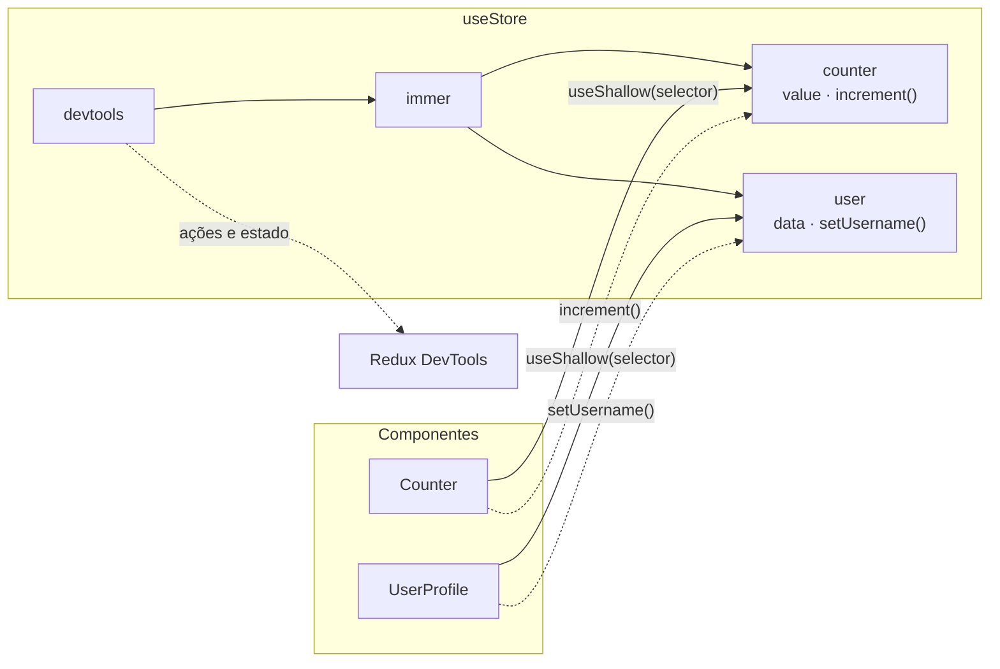

# Zustand Course


Projeto prático de curso para explorar o gerenciamento de estado com [Zustand](https://zustand.docs.pmnd.rs/) em React, cobrindo stores tipadas, selectors, slices e middlewares.

## Tech stack

| Tecnologia | Uso |
| --- | --- |
| [React 19](https://react.dev/) | Biblioteca de interface, com React Compiler |
| [Vite](https://vite.dev/) | Bundler e servidor de desenvolvimento |
| [TypeScript](https://www.typescriptlang.org/) | Tipagem estática |
| [Zustand](https://zustand.docs.pmnd.rs/) | Gerenciamento de estado, com middleware `immer` |
| [Tailwind CSS v4](https://tailwindcss.com/) | Estilização |
| [shadcn/ui](https://ui.shadcn.com/) | Componentes de interface (Base UI) |
| [Biome](https://biomejs.dev/) | Lint e formatação |
| [Husky](https://typicode.github.io/husky/) + [commitlint](https://commitlint.js.org/) | Git hooks e validação das mensagens de commit |

## Arquitetura



## O que foi abordado

| Tópico | Descrição |
| --- | --- |
| Store tipada | `create<IStore>()()` com generics e tipos cientes de middleware |
| Selectors | Consumir apenas o estado de que cada componente precisa |
| `useShallow` | Evitar re-renders desnecessários em selectors que retornam objetos |
| Slices | Store dividida nos slices `counter` e `user` |
| Middleware `devtools` | Inspeção da store no Redux DevTools |
| Middleware `immer` | Atualizações de estado com sintaxe mutável |
| Middleware `persist` | Persistência da store no `sessionStorage` (presente no histórico de commits) |
| Middleware customizado | `logOperations` para registrar as mutações da store (presente no histórico de commits) |

## Getting started

### Pré-requisitos

- [Node.js](https://nodejs.org/) 20 ou superior
- [pnpm](https://pnpm.io/installation)

### Instalação

1. Clone o repositório:

   ```bash
   git clone https://github.com/andersonkaiti/zustand-course.git
   cd zustand-course
   ```

2. Instale as dependências:

   ```bash
   pnpm install
   ```

3. Inicie o servidor de desenvolvimento:

   ```bash
   pnpm dev
   ```

4. Abra [http://localhost:5173](http://localhost:5173) no navegador.

### Scripts disponíveis

| Comando | Descrição |
| --- | --- |
| `pnpm dev` | Inicia o servidor de desenvolvimento |
| `pnpm build` | Verifica os tipos e gera o build de produção |
| `pnpm preview` | Visualiza o build de produção localmente |
